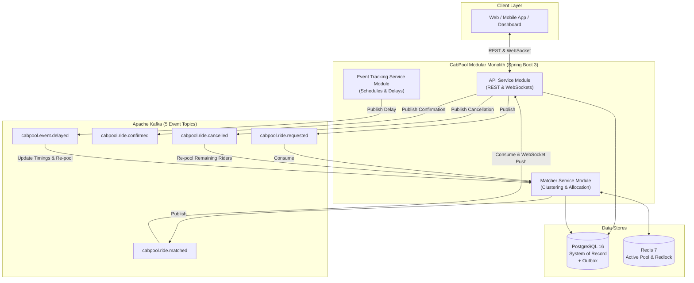

# 📖 CabPool: Comprehensive Developer Handover & Architecture Manual

> **Purpose:** This document is the primary onboarding guide for any software engineer taking over the CabPool codebase. It explains the domain problem, runtime infrastructure, code organization, event pipelines, concurrency guarantees, and next steps for production deployment.

---

## Table of Contents
1. [Domain Problem & Core Value Proposition](#1-domain-problem--core-value-proposition)
2. [Architectural Pattern: Modular Monolith vs. Microservices](#2-architectural-pattern-modular-monolith-vs-microservices)
3. [Infrastructure & Tech Stack](#3-infrastructure--tech-stack)
4. [Database & Data Model Deep Dive](#4-database--data-model-deep-dive)
5. [Event-Driven Pipeline: The 5 Kafka Topics](#5-event-driven-pipeline-the-5-kafka-topics)
6. [Component Walkthrough by Package](#6-component-walkthrough-by-package)
7. [Concurrency & Distributed Systems Edge Cases](#7-concurrency--distributed-systems-edge-cases)
8. [Local Development, Running & Testing](#8-local-development-running--testing)
9. [Developer Roadmap & Next Implementation Steps](#9-developer-roadmap--next-implementation-steps)

---

## 1. Domain Problem & Core Value Proposition

In high-density transit nodes (airports like Bengaluru KIA, concert stadiums, sports venues, tech park shifts), hundreds of passengers leave or converge simultaneously heading toward similar residential or office clusters (e.g., HSR Layout, Whitefield, Indiranagar).

Individual cabs cause severe road congestion and high costs (₹1200+ per cab). Public transit is often inflexible.
**CabPool** solves this by grouping 2 to 4 independent commuters heading in the same direction into a single shared cab with:
1. **Dynamic Schedule Matching:** Matches riders whose flight/train arrival or concert end time falls within a compatible window ($\Delta t \le 30\text{ mins}$).
2. **Geographic Cluster Drop-Off:** Clusters by destination zone and sorts drop sequence by latitude/longitude distance.
3. **Safety / Women-Only Filter:** Strictly restricts `WOMEN_ONLY` groups to verified female accounts.
4. **Dynamic Event Delay Rescheduling:** Ingests flight/concert delay feeds and shifts proposed pickup windows dynamically.
5. **Fault-Tolerant Re-Matching:** When a rider cancels, the remaining passengers are returned to the pool and re-matched.

---

## 2. Architectural Pattern: Modular Monolith vs. Microservices

CabPool is implemented as an **Event-Driven Modular Monolith**:
* **Why one application?** Running 3 distinct Spring Boot microservices on local machines requires 3 separate JVMs, 3 debugger sessions, and intricate service discovery. For an MVP and college demonstration, this adds operational friction without architectural benefit.
* **Why Modular?** The codebase has strict module boundaries (`api`, `matcher`, `flight/event`). They do **not** call each other directly via Java service method injection. Instead, **they communicate strictly over Kafka event topics and decoupled Redis/Postgres datastores**.
* **How to split into 3 independent microservices later:**
  1. Move `com.cabpool.api` into `cabpool-api-service` with its own `Dockerfile`.
  2. Move `com.cabpool.matcher` into `cabpool-matcher-service`.
  3. Move `com.cabpool.flight` into `cabpool-event-service`.
  4. Share the `event` DTOs as a common Maven library. No business logic needs to change.



---

## 3. Infrastructure & Tech Stack

| Technology | Version | Purpose in this System |
|---|---|---|
| **Java** | 21+ / 25 | Modern LTS runtime supporting virtual threads and records |
| **Spring Boot** | 3.3.5 | Core dependency injection, MVC, WebSocket (STOMP), and Data JPA |
| **Apache Kafka** | 3.8.0 | High-throughput distributed message broker for async decoupling |
| **Redis** | 7.0 (Alpine) | Ultra-low latency in-memory candidate cache + Redlock distributed mutex |
| **PostgreSQL** | 16 | ACID-compliant relational system of record (users, requests, groups) |
| **Docker Compose** | v2+ | Local infrastructure orchestrator |
| **Lombok** | 1.18+ | Reduces boilerplate getters/setters/builders |

---

## 4. Database & Data Model Deep Dive

The schema is defined in [`schema.sql`](file:///c:/Users/SARIKA PANDEY/Desktop/project-college/schema.sql) and mapped via JPA in `com.cabpool.entity.*`.

### 1. `users` Table
Stores registered rider accounts.
* `id` (UUID PRIMARY KEY): Universal unique identifier.
* `name`, `email` (UNIQUE), `phone`: User credentials and contact info.
* `gender` (`FEMALE`, `MALE`, `OTHER`): Enforces women-only pool filtering.
* `verified` (BOOLEAN): Must be `TRUE` for female users before requesting a women-only pool.

### 2. `ride_requests` Table
Represents an individual person asking for a shared cab.
* `venue` (VARCHAR(50)): The pickup/destination hub (e.g. `KIA_AIRPORT`, `CHINNASWAMY_STADIUM`).
* `direction` (`FROM_VENUE`, `TO_VENUE`): Direction of commuter flow.
* `event_identifier` (VARCHAR(60)): Flight number (`Flight 6E-204`) or event (`Coldplay Tour`).
* `target_time` (TIMESTAMPTZ): Flight landing time, concert end time, or shift departure time.
* `max_wait_minutes` (INT, default 30): How long the rider is willing to wait at the venue.
* `drop_address`, `drop_lat`, `drop_lng`, `drop_zone`: Destination geolocation and zone code (`HSR`, `WHITEFIELD`).
* `preference` (`MIXED`, `WOMEN_ONLY`): Safety preference.
* `status` (`OPEN`, `MATCHED`, `CONFIRMED`, `CANCELLED`, `EXPIRED`).
* `version` (BIGINT): **Optimistic locking column** preventing dirty concurrent updates.

### 3. `ride_groups` Table
Represents a formed cab pool of 2 to 4 passengers.
* `status` (`PROPOSED`, `CONFIRMED`, `CANCELLED`, `COMPLETED`).
* `planned_pickup_time`: Calculated as $\max(\text{target\_times}) + 15\text{ mins}$.
* `est_total_fare`: Total cab fare (e.g., ₹1200 split equally among riders).

### 4. `ride_group_members` Table
Associative entity mapping requests into groups.
* `(group_id, request_id)`: Composite Primary Key.
* **`request_id UNIQUE`**: **CRITICAL CONSTRAINT.** Physical database guarantee that a request ID can never be assigned to more than one group simultaneously.
* `drop_order`: 1 to 4 (ordered by optimal drop sequence).
* `share_amount`: Calculated fare share per rider.
* `accepted` (BOOLEAN): Tracks mutual acceptance.

### 5. `outbox_events` Table
Implements the **Transactional Outbox Pattern**:
* When an entity is saved, an event row is written in the exact same database transaction.
* An outbox worker or CDC tool (Debezium) reads this table to stream to Kafka, solving the dual-write failure gap.

---

## 5. Event-Driven Pipeline: The 5 Kafka Topics

```
[API Service] ────────── cabpool.ride.requested ─────────▶ [Matcher Service]
                                                                  │
[API Service] ◀────────── cabpool.ride.matched ─────────── [Matcher Service]
      │
[Rider Client Accepts]
      │
[API Service] ────────── cabpool.ride.confirmed ─────────▶ [Ticketing / Notification]
      │
[Rider Cancels]
      │
[API Service] ────────── cabpool.ride.cancelled ─────────▶ [Matcher Service (Re-match)]
                                                                  ▲
[Event Tracker] ──────── cabpool.event.delayed ───────────────────┘
```

1. **`cabpool.ride.requested`**:
   * *Producer:* `RideService.createRideRequest()`
   * *Consumer:* `MatcherConsumer.onRideRequested()`
   * *Action:* Matcher stores request in Redis candidate pool and checks for cluster matches.
2. **`cabpool.ride.matched`**:
   * *Producer:* `MatcherAlgorithmService.createAndSaveGroup()`
   * *Consumer:* `ApiEventConsumer.onGroupProposed()`
   * *Action:* API service broadcasts match proposal over WebSocket (`/topic/rider/{userId}`).
3. **`cabpool.ride.confirmed`**:
   * *Producer:* `RideService.acceptGroupProposal()`
   * *Action:* Fires when all members click "Accept". Finalizes group.
4. **`cabpool.ride.cancelled`**:
   * *Producer:* `RideService.cancelRideRequest()`
   * *Consumer:* `MatcherConsumer.onRideCancelled()`
   * *Action:* Dissolves existing group, extracts remaining riders, resets their status to `OPEN`, pushes them back to Redis, and re-triggers matching.
5. **`cabpool.event.delayed`**:
   * *Producer:* `EventTrackingService.broadcastEventDelay()`
   * *Consumer:* `MatcherConsumer.onEventDelayed()`
   * *Action:* Updates target time in Postgres & Redis pool; recalculates wait windows.

---

## 6. Component Walkthrough by Package

```
com.cabpool
├── common.enums      # Domain enums (Gender, Direction, Statuses)
├── entity            # JPA Hibernate entities mapping schema.sql
├── repository        # Spring Data JPA interfaces
├── event             # Serialization DTOs for Kafka messages
├── config            # Kafka, Redis, WebSocket, and Seed Data configurations
├── api               # Ingestion endpoints & real-time WebSocket push
├── matcher           # In-memory Redis candidate pool, Redlock & matching engine
└── flight            # Event delay tracking (Concerts, Flights, Stadium matches)
```

### Key Classes to Know:
* [`MatcherAlgorithmService.java`](file:///c:/Users/SARIKA PANDEY/Desktop/project-college/src/main/java/com/cabpool/matcher/service/MatcherAlgorithmService.java): The core clustering engine. Filters candidates by time overlap, destination proximity, and women-only rules.
* [`RedisPoolService.java`](file:///c:/Users/SARIKA PANDEY/Desktop/project-college/src/main/java/com/cabpool/matcher/service/RedisPoolService.java): Manages active requests in Redis Hash keys (`cabpool:active_pool:{venue}:{direction}:{zone}`). Contains the atomic Lua script for distributed lock release.
* [`RideService.java`](file:///c:/Users/SARIKA PANDEY/Desktop/project-college/src/main/java/com/cabpool/api/service/RideService.java): Coordinates request ingestion, member acceptance tracking, and cancellation re-pooling.
* [`RiderNotificationService.java`](file:///c:/Users/SARIKA PANDEY/Desktop/project-college/src/main/java/com/cabpool/api/service/RiderNotificationService.java): Pushes real-time alerts to WebSockets over STOMP topics (`/topic/rider/{userId}`).

---

## 7. Concurrency & Distributed Systems Edge Cases

### A. The "Double-Match" Race Condition
**Problem:** Two matcher instances (or threads) simultaneously inspect the candidate pool and both try to add Rider A to two different cars.
**Defense in CabPool (Defense in Depth):**
1. **Redis Redlock:** Before creating a group, Matcher acquires distributed locks (`cabpool:lock:{requestId}`) for all candidate IDs using `SET key owner NX EX 15`. If any lock fails, all acquired locks are safely released and matching skips this pass.
2. **PostgreSQL Optimistic Locking (`@Version`):** Stops concurrent UPDATE collisions on requests.
3. **Database Unique Constraint (`UNIQUE(request_id)` on `ride_group_members`):** If two concurrent INSERT transactions bypass the lock, PostgreSQL rejects the second transaction with a Unique Constraint Violation. Double-matching is physically impossible.

### B. Safe Distributed Lock Release (Atomic Lua Script)
**Problem:** In a naive implementation (`GET key` followed by `DEL key`), the lock might expire right after the `GET`. Worker B acquires the lock. Worker A then executes `DEL`, mistakenly deleting Worker B's lock!
**Solution:** [`RedisPoolService`](file:///c:/Users/SARIKA PANDEY/Desktop/project-college/src/main/java/com/cabpool/matcher/service/RedisPoolService.java) executes an atomic Lua script:
```lua
if redis.call('get', KEYS[1]) == ARGV[1] then
    return redis.call('del', KEYS[1])
else
    return 0
end
```

### C. The Dual-Write Gap (Transactional Outbox)
**Problem:** Saving to PostgreSQL and publishing to Kafka are two distinct operations across two distinct systems (no distributed 2-Phase Commit). If the app dies right after Postgres commits, Kafka never gets the message.
**Solution:** The `outbox_events` table is committed in the same database transaction. A CDC worker guarantees At-Least-Once publication.

---

## 8. Local Development, Running & Testing

### 1. Prerequisites
* **Docker Desktop** installed and running.
* **IntelliJ IDEA** or VS Code with JDK 21+ support.

### 2. Start Infrastructure
Open PowerShell:
```powershell
cd "c:\Users\SARIKA PANDEY\Desktop\project-college"
docker compose up -d
```
Verify that all 3 containers are healthy:
```powershell
docker compose ps
```

### 3. Start Spring Boot
Open `c:\Users\SARIKA PANDEY\Desktop\project-college` in IntelliJ IDEA.
Run [`CabPoolApplication.java`](file:///c:/Users/SARIKA PANDEY/Desktop/project-college/src/main/java/com/cabpool/CabPoolApplication.java).
*Note: Test users (`Priya`, `Ananya`, `Rahul`, `Vikram`) are seeded automatically on first boot.*

### 4. Interactive Testing
Open your browser to:
👉 **`http://localhost:8080/index.html`**

#### Verification Test Cases:
1. **Standard Match:** Book Priya (KIA_AIRPORT, HSR) $\rightarrow$ Book Ananya (KIA_AIRPORT, HSR). Observe real-time WebSocket match popup and fare split.
2. **Cancellation & Re-matching:** Click "Cancel Request" on Priya. Observe `cabpool.ride.cancelled` event fire. Ananya is automatically restored to `OPEN` and returned to the candidate pool!
3. **Schedule Delay:** Change delay to 30 mins and click "Broadcast Delay". Observe the updated target time propagate through `cabpool.event.delayed`.

---

## 9. Developer Roadmap & Next Implementation Steps

For any developer continuing this codebase, here are the logical next enhancements:

1. **Mapbox / Google Distance Matrix Integration:**
   * Currently, drop order is sorted by latitude/longitude distance.
   * *Next step:* Call Google Distance Matrix API or Open Source Routing Machine (OSRM) to calculate realistic driving durations and detours.
2. **Debezium CDC Connector for Outbox:**
   * Connect Debezium Postgres CDC connector to stream from `outbox_events` to Kafka automatically, eliminating manual `kafkaTemplate.send()` calls in the service layer.
3. **Microservices Containerization:**
   * Break the single `pom.xml` into a Maven multi-module project:
     * `cabpool-common` (entities, event DTOs)
     * `cabpool-api-service`
     * `cabpool-matcher-service`
     * `cabpool-event-service`
   * Add individual Dockerfiles for each service and update `docker-compose.yml` to run the entire backend in Docker.
4. **Dynamic Fare Pricing Algorithm:**
   * Implement surge pricing / shared savings formula:
     $$\text{Fare}_{\text{rider}} = \text{SoloFare} \times (1 - 0.20 \times (\text{GroupSize} - 1))$$
