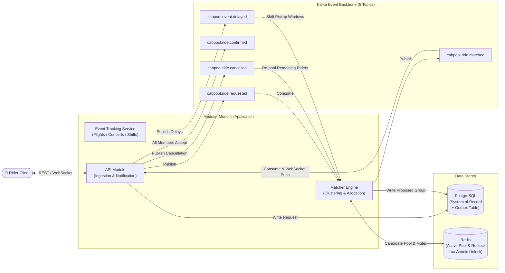

# 🚖 CabPool: Event-Driven Distributed Ride-Sharing Architecture

An event-driven distributed system designed for shared ride-pooling across **high-density venues and scheduled events** (Airports, Concerts, Stadiums, Tech Parks) with dynamic schedules, women-only safety pooling, distributed locking, and event cancellation with automatic re-matching.

Built with **Spring Boot 3**, **Apache Kafka** (5 event topics), **Redis** (candidate pool & Redlock with atomic Lua script), and **PostgreSQL** (ACID system of record).

---

## 🏛️ Architecture & System Boundary: Modular Monolith vs. Microservices

> [!NOTE]
> **Viva Defense Insight:**
> This codebase is implemented as a **Modular Monolith** with clear domain boundaries.
> All three modules (`API Module`, `Matcher Engine`, and `Event Tracking Service`) run within one deployable Spring Boot application for development simplicity, **but they communicate exclusively through Kafka event topics and decoupled data layers**.
> If an examiner asks: *"Is this one app or three services?"*
> **Answer honestly:** *"It is built as a Modular Monolith. The domain modules have strict internal boundaries and interact through 5 Kafka topics and Redis. Because communication is decoupled via Kafka, each module can be extracted into an independently deployable containerized microservice without changing the business logic."*



---

## 📡 The 5 Core Kafka Topics & Event Lifecycle

| # | Topic Name | Producer | Consumer | Business Trigger & Consequence |
|---|---|---|---|---|
| **1** | `cabpool.ride.requested` | API Module | Matcher Engine | Rider submits a ride request. Request is added to the in-memory Redis pool for candidate matching. |
| **2** | `cabpool.ride.matched` | Matcher Engine | API Module | Matcher clusters 2–4 compatible riders, acquires Redis locks, writes proposed group to Postgres, and notifies riders over WebSockets. |
| **3** | `cabpool.ride.confirmed` | API Module | Notification / External | Emitted when all members in a proposed group accept their fare share and drop sequence. Finalizes booking. |
| **4** | `cabpool.ride.cancelled` | API Module | Matcher Engine | **Cancellation & Re-matching:** When a rider cancels, the group is dissolved. The *remaining* non-cancelling riders are restored to `OPEN` status, pushed back into Redis, and immediately re-matched! |
| **5** | `cabpool.event.delayed` | Event Tracking Service | Matcher Engine & API | Ingests delays for flights, concerts, matches, or campus shifts. Matcher shifts target pickup windows dynamically. |

---

## 🌐 Generalization: Beyond Airports to Venues & Events

The system is not restricted to airport flights:
* **Venues (`venue`)**:
  * Airports (`KIA_AIRPORT`, `DEL_T3`)
  * Stadiums (`CHINNASWAMY_STADIUM`, `DY_PATIL`)
  * Tech Parks (`MANYATA_TECH_PARK`, `ECOSPACE`)
* **Direction (`direction`)**:
  * `FROM_VENUE`: Commuters leaving a venue heading towards residential clusters (e.g. HSR, Whitefield, Indiranagar).
  * `TO_VENUE`: Commuters leaving dispersed zones converging to the same venue/event.
* **Events (`event_identifier`)**:
  * Flight numbers (`Flight 6E-204`)
  * Concerts (`Coldplay Music of the Spheres`)
  * Sporting events (`IPL RCB vs CSK`)
  * Corporate shift end times (`Evening Shift 20:00`)

---


### 1. Does the Redis lock release safely?
* **Problem**: In a simple `GET lock` followed by `DEL lock`, the lock could expire right after the `GET`. Another worker acquires it, and the first worker inadvertently deletes the second worker's lock!
* **Solution**: We use an **Atomic Lua Script**:
  ```lua
  if redis.call('get', KEYS[1]) == ARGV[1] then
      return redis.call('del', KEYS[1])
  else
      return 0
  end
  ```
  This guarantees that a worker can *only* delete a lock if it still holds the exact unique `lockOwner` token.

### 2. Does `@Version` do what you think?
* **Answer**: `@Version` prevents **concurrent updates** to an existing record (`UPDATE ... WHERE id = ? AND version = ?`).
* It does **not** prevent concurrent **inserts**.
* That is why `ride_group_members` has a database-level `UNIQUE(request_id)` constraint. If two matchers try to insert the same rider into two different groups at the exact same millisecond, the database throws `DataIntegrityViolationException`, physically preventing double-matching.

### 3. How to address the "Save-then-Publish" Dual-Write Gap?
* **Problem**: If the application saves a `RideRequest` in PostgreSQL and crashes before emitting to Kafka, the request is stored but never matched.
* **Solution**: The **Transactional Outbox Pattern** (included in `schema.sql` via `outbox_events` table).
  1. Save `RideRequest` and an `outbox_events` record in the **same database transaction**.
  2. A Debezium CDC engine or poller reads the outbox table and streams to Kafka with guaranteed At-Least-Once delivery.

### 4. Performance: Measured Timings vs Unsubstantiated Claims
* Rather than claiming static numbers like "<1ms", the system actively measures and logs execution timestamps (`durationMs = System.currentTimeMillis() - startTime`).
* Responses return `measuredIngestionTimeMs` to demonstrate realistic, measured latency.

---

## 🚀 Running the Project

### 1. Start Infrastructure
Start Docker Desktop, then:
```powershell
docker compose up -d
```
Verify all three containers are healthy:
```powershell
docker compose ps
```

### 2. Run the Application
Open the project in IntelliJ IDEA, open `CabPoolApplication.java`, and click **Run ▶**.

### 3. Open the Interactive Dashboard
Navigate to:
👉 **`http://localhost:8080/index.html`**

Test the 5-topic lifecycle:
1. Book for **Priya** (`KIA_AIRPORT`, `HSR`, `WOMEN_ONLY`).
2. Book for **Ananya** (`KIA_AIRPORT`, `HSR`, `WOMEN_ONLY`).
3. Observe the match proposal over Kafka & WebSockets.
4. Click **Cancel Request** on one rider $\rightarrow$ Observe `cabpool.ride.cancelled` topic fire and the remaining rider return to the pool for **re-matching**!
5. Trigger an **Event Delay** (+30 mins) to see schedules update dynamically.
